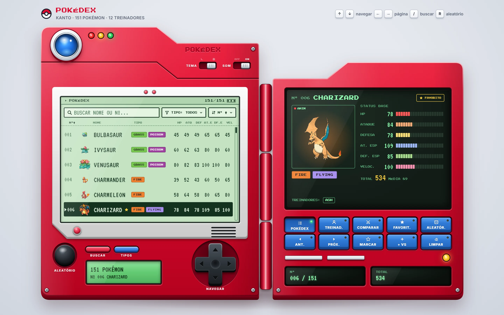
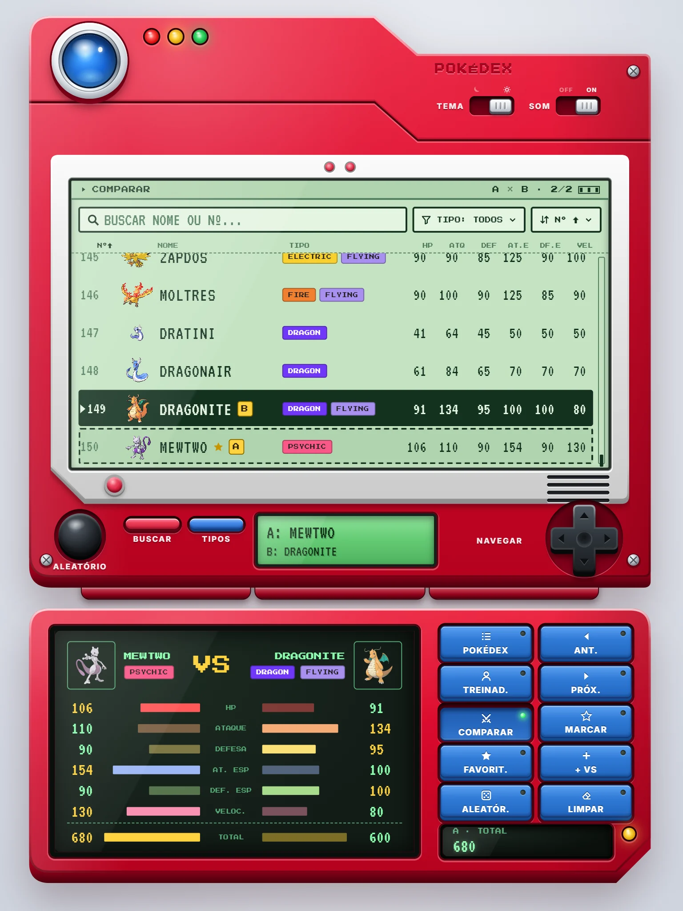
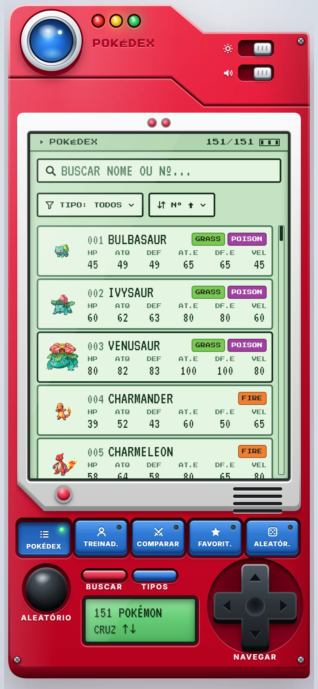
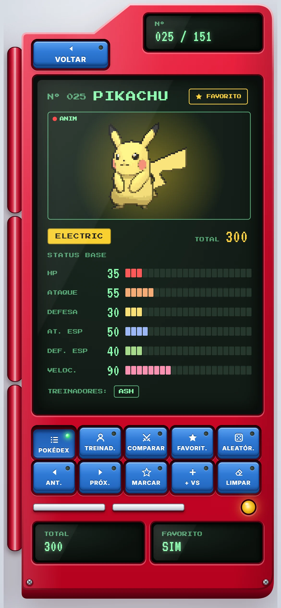
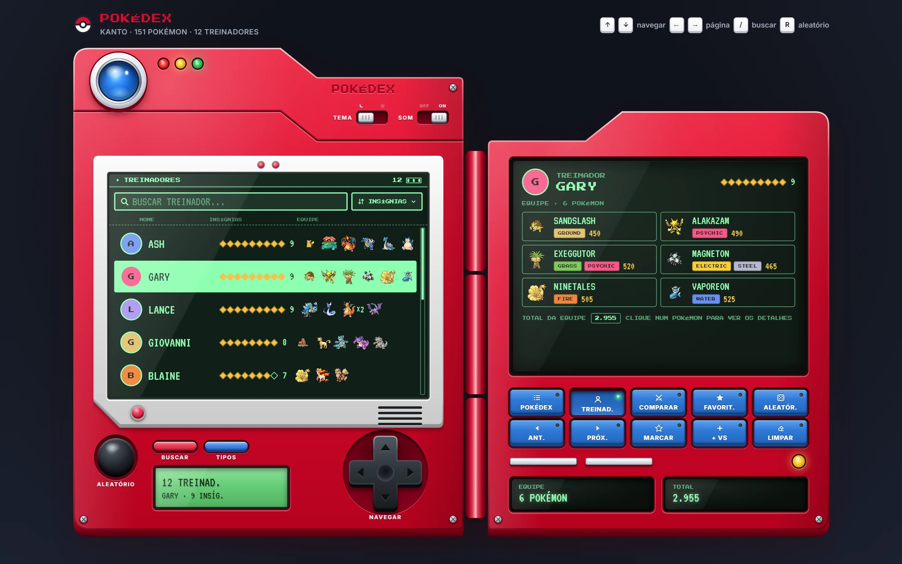

# Pokédex de Kanto · React + Vite

Pokédex dos 151 Pokémon da primeira geração, feita para a **Atividade 03 de Desenvolvimento e Integração de Aplicações Web** (PUC Minas).
A interface imita o aparelho clássico de Kanto, desenhado em CSS e SVG próprios: a tampa abre ao iniciar, os LEDs acendem, a cruz e os botões navegam pela lista.
Dentro das telas fica a parte "site": lista com busca, filtro, ordenação, detalhes, treinadores, favoritos e comparação.



| Tablet · comparação | Celular · lista | Celular · detalhes |
|---|---|---|
|  |  |  |



## Dupla

- Daniel Oliveira de Menezes
- _(segundo integrante)_

## Como rodar

Precisa do **Node.js 18 ou mais novo** (o projeto usa o Vite 5).

```bash
npm install
npm run dev
```

Abra **http://localhost:5173** no navegador e clique na Pokédex (ou aperte Enter) para abrir a tampa.

Para gerar e testar a versão de produção:

```bash
npm run build
npm run preview
```

A versão de produção fica em `dist/` e abre em **http://localhost:4173**.

## O que a Pokédex faz

**Pedido no enunciado**

- Lista dos 151 Pokémon com Nº, nome, tipos e os 6 status (HP, Ataque, Defesa, At. Esp., Def. Esp. e Velocidade).
- Busca por nome ou número, atualizada a cada letra digitada (aceita `25`, `025`, `#25` e nomes sem acento).
- Filtro pelos tipos do JSON, cada um com a quantidade de Pokémon ao lado.
- Tela de detalhes com arte, tipos, status em barras, total, média e os treinadores que têm aquele Pokémon.
- Área de treinadores com nome, insígnias e equipe, com busca e ordenação; clicar num Pokémon da equipe abre os detalhes dele.
- Estado vazio quando a busca ou o filtro não encontram nada, com botão para limpar.
- Layout próprio para computador, tablet e celular.

**Extras**

- Favoritos salvos no navegador.
- Comparação entre dois Pokémon, status por status, com o vencedor destacado.
- Ordenação por Nº, nome, total ou qualquer status, em ordem crescente ou decrescente (também clicando no título da coluna).
- Pokémon aleatório.
- Tema claro (LCD verde) e escuro (fósforo).
- Som dos botões, que pode ser desligado.
- Imagens da PokéAPI (ver abaixo).
- Animação de abertura do aparelho, que respeita a opção "reduzir movimento" do sistema.

### Controles

| Aparelho | Teclado | Ação |
|---|---|---|
| Cruz ▲ ▼ | ↑ ↓ | Pokémon ou treinador anterior / próximo |
| Cruz ◀ ▶ | ← → | Pula uma página da lista |
| Pílula vermelha | `/` | Vai para a busca |
| Pílula azul | | Abre o filtro de tipos |
| Botão preto | `R` | Pokémon aleatório |
| MARCAR | `F` | Marca ou desmarca o favorito |
| + VS | `C` | Coloca o Pokémon na comparação |
| Chave TEMA | `T` | Alterna tema claro e escuro |
| Chave SOM | `M` | Liga ou desliga o som |
| | Enter | Na busca, abre o primeiro resultado |
| | Esc | Fecha o painel aberto, sai da busca ou limpa a seleção |

As teclas azuis da tampa trocam o modo (Pokédex, Treinadores, Comparar, Favoritos) e fazem as ações da lista (anterior, próximo, marcar, + VS, limpar).

## Onde estão os dados

- **`src/data/pokedex-data.json`**: o arquivo da atividade, sem alterações (151 Pokémon, 18 tipos e 12 treinadores).
- **`src/data/dados.js`**: lê o JSON e prepara o que as telas usam: total de status, contagem por tipo, equipes dos treinadores e as funções de busca e ordenação.
  - O Mew vem sem tipo no JSON e aparece como **Typeless** (o tipo de id 0 do próprio arquivo).
  - O filtro mostra só os 17 tipos que têm Pokémon (nenhum é Dark).
  - Pokémon repetidos numa equipe (Koga, Lance) aparecem uma vez com "×N".
- **`src/data/animacoes.json`**: lista dos ids que têm animação própria em `public/animations/`.
- **No navegador (localStorage):** tema (`pokedex:tema`), som (`pokedex:som`), favoritos (`pokedex:favoritos`) e o cache das imagens (`pokedex:imagens:v1`).

## API externa: PokéAPI

Os dados da lista vêm só do JSON. A internet é usada apenas para as **imagens**:

- Endpoint: `https://pokeapi.co/api/v2/pokemon/{id}` ([PokéAPI](https://pokeapi.co/), gratuita e sem chave).
- Campos usados: `sprites.front_default` (sprite da lista), `sprites.other["official-artwork"].front_default` (arte dos detalhes) e `sprites.other.showdown.front_default` (GIF animado dos detalhes).
- As imagens em si vêm do repositório [PokeAPI/sprites](https://github.com/PokeAPI/sprites).
- Cada Pokémon é buscado uma vez só, quando a linha aparece na tela, e fica guardado em memória e no localStorage.
- **Sem internet**, tudo continua funcionando com os dados do JSON e as imagens viram um desenho reserva.

Nos detalhes, a imagem segue esta ordem: animação própria (vídeo em `public/animations/{id}.webm`) → GIF animado → arte oficial → desenho reserva.
Como gerar as animações próprias com o Higgsfield está em [docs/animacoes.md](docs/animacoes.md).

## Organização do projeto

```text
pokedex/
├── index.html
├── package.json
├── vite.config.js
├── public/
│   ├── favicon.svg
│   └── animations/          animações próprias ({id}.webm)
├── src/
│   ├── main.jsx             ponto de entrada (importa os CSS)
│   ├── App.jsx              escolhe o aparelho conforme a tela e liga as telas
│   ├── index.css            fontes, fundo da página
│   ├── css/                 tokens (cores, medidas), aparelho, LCD, tela da tampa, estados
│   ├── data/                JSON da atividade, preparação dos dados, lista de animações
│   ├── hooks/
│   │   ├── usePokedex.js    todo o estado da Pokédex e as ações dos botões
│   │   ├── useLayout.js     computador, tablet ou celular e a escala do aparelho
│   │   ├── usePokeApi.js    imagens da PokéAPI com cache
│   │   ├── useTeclado.js    atalhos de teclado
│   │   ├── useSom.js        bipes com Web Audio
│   │   └── ...              localStorage, reduzir movimento, item visível na tela
│   ├── components/
│   │   ├── aparelho/        carcaça, peças (lente, LEDs, cruz, teclas) e os 3 aparelhos
│   │   ├── lcd/             tela principal: busca, filtro, ordenação, lista, treinadores
│   │   ├── tampa/           tela da tampa: resumo, detalhes, treinador, comparação
│   │   └── comum/           ícones, chips de tipo, sprite e arte do Pokémon
│   └── assets/              fontes (Inter, Press Start 2P, VT323) e imagem reserva
├── design/                  fonte do design: tokens, mockups em HTML e plugin do Figma
└── docs/                    capturas de tela e guia das animações
```

O aparelho tem um tamanho fixo para cada formato (computador 1240×900, tablet 744×1030, celular 380×844) e é ampliado ou reduzido para caber na janela, como uma imagem.
O formato muda pela largura e pela proporção da janela.

## Design

O design foi feito antes no Figma (referências, tokens, wireframes, telas em alta fidelidade nos 3 tamanhos e protótipo):
[Pokédex · Atividade 03 no Figma](https://www.figma.com/design/iSiZLzxXtbJjz2jQMi2C6f).
As cores e medidas do Figma e do código saem do mesmo arquivo, `design/src/tokens.css`.

## Tecnologias

- React 18 e Vite 5, sem bibliotecas além das que vêm com o template.
- CSS puro, com variáveis para os dois temas.
- Fontes [Inter](https://rsms.me/inter/), [Press Start 2P](https://fonts.google.com/specimen/Press+Start+2P) e [VT323](https://fonts.google.com/specimen/VT323) (licença OFL), servidas pelo próprio projeto.

---

Projeto acadêmico, sem fins comerciais. Pokémon e os nomes dos personagens são marcas da Nintendo, Creatures e Game Freak.
